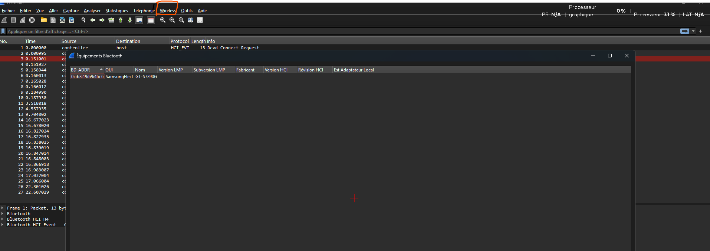

# Bluetooth - Fichier inconnu

## Infos

> Challenge réalisé au terminal (Linux) : les étapes sont retranscrites en commandes, il n'y a donc pas de captures d'écran.

- Catégorie : Réseau
- Difficulté / Points :
- Fichiers / URL fournis : une capture Bluetooth

## Énoncé

Votre ami travaillant à l’ANSSI a récupéré un fichier illisible dans l’ordi d’un hacker. Tout ce qu’il sait est que cela provient d’un échange entre un ordinateur et un téléphone. A vous d’en apprendre le plus possible sur ce téléphone.

La réponse est le hash SHA1 de la concaténation de l’adresse MAC (en majuscules) et du nom du téléphone.

## TL;DR

En analysant la capture Bluetooth, on retrouve l'adresse de l'appareil et son nom de modèle, qui constituent la réponse.

## Reconnaissance / Exploitation

1. Ouvrir le fichier avec wireshark
2. Décoder dans wireshark wireless -> Equipement bluetooth

En lisant la capture, j'ai relevé :
- Adresse de l'appareil : `0C:B3:19:B9:4F:C6`
- Nom / modèle : `GT-S7390G`

## Flag

`masqué` *(règles Root-Me)*

## Ce que j'ai appris

1 Lire une capture bluetooth les détails du paquet 
2 Utiliser des outils integrer a wireshark pour lire des donnés bluetooth
