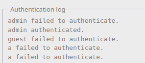
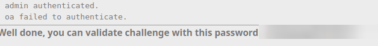

# CRLF

## Infos

- Catégorie : Web - Serveur
- Difficulté / Points :
- Fichiers / URL fournis : page de connexion avec un journal d'authentification

## Énoncé

Injectez des données erronées dans le fichier de journalisation

## TL;DR

Le nom d'utilisateur est écrit tel quel dans le fichier de log. En injectant les caractères **CR** et **LF** (`%0D%0A`), on peut créer une nouvelle ligne et ajouter une fausse entrée dans le journal : c'est une **injection CRLF**, ici utilisée pour faire du **log poisoning**.

## Reconnaissance

La page affiche le journal d'authentification. On remarque que ce qu'on tape dans le champ `username` se retrouve directement dans le log, par exemple `a failed to authenticate.` quand je me connecte avec `a`.



Le champ `username` est donc le champ vulnérable : il est réécrit sans filtrage dans le fichier de log.

Petit rappel :
- `\r` = **CR** (*Carriage Return*) = `%0D` en encodage URL
- `\n` = **LF** (*Line Feed*) = `%0A` en encodage URL

## Exploitation

L'idée est de faire croire que l'admin s'est bien connecté. J'envoie un username qui contient `admin authenticated.`, suivi d'un retour à la ligne `%0D%0A` :

```txt
?username=admin%20authenticated.%0D%0Aoa&password=aa
```

Le serveur écrit alors deux lignes dans le log :
1. `admin authenticated.` : la ligne que j'ai injectée
2. `oa failed to authenticate.` : la suite, complétée automatiquement par l'application



## Flag

`masqué` *(règles Root-Me)*

## Ce que j'ai appris

- Une injection CRLF permet de forcer un retour à la ligne quand une entrée est réécrite telle quelle dans un log ou dans des en-têtes HTTP.
- Dans les logs, ça permet de cacher une intrusion ou de tromper celui qui les analyse.
- Dans une réponse HTTP, ça peut permettre d'ajouter ses propres en-têtes (**HTTP Response Splitting**), mais seulement si l'entrée sert à construire les en-têtes de la réponse.
- Pour corriger : supprimer ou encoder `\r` et `\n` avant d'écrire une entrée utilisateur dans un log.
