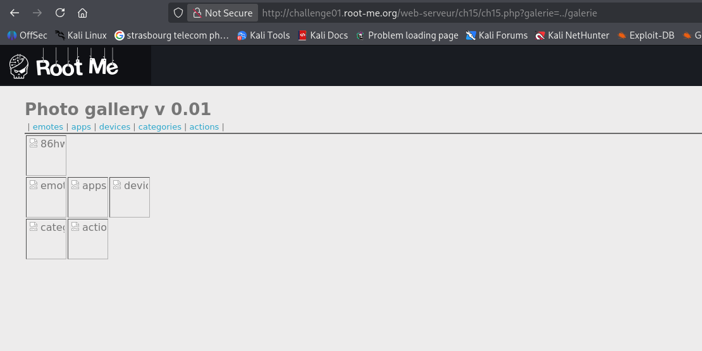
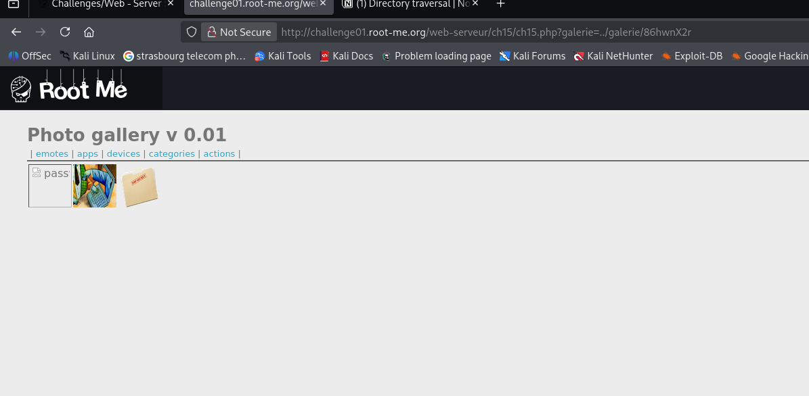

# Directory traversal

## Infos

- Catégorie : Web - Serveur
- Difficulté / Points : 25 points
- Fichiers / URL fournis : http://challenge01.root-me.org/web-serveur/ch15/ch15.php

## Énoncé

Find the hidden section of the photo galery.

## TL;DR

Le paramètre `galerie` de l'URL indique quel dossier afficher, sans vérification. En utilisant `../`, on peut remonter dans l'arborescence et afficher un dossier caché : c'est un **directory traversal** (ou *path traversal*).

## Reconnaissance

Le nom du challenge donne déjà un indice : on va chercher du côté des **paramètres de l'URL** pour naviguer dans les répertoires et exposer quelque chose de caché.

Rappel de la structure d'une URL :


L'URL de base ressemble à ça :

```txt
http://challenge01.root-me.org/web-serveur/ch15/ch15.php?galerie=emotes
```

On accède aux images grâce au paramètre `galerie` : sa valeur est le dossier qu'on veut afficher.

## Exploitation

1. J'essaie de revenir en arrière avec `../` pour voir le contenu du dossier parent :
   ```txt
   ch15.php?galerie=../galerie
   ```
   On voit apparaître un dossier qui n'est pas dans le menu : `86hwnX2r`.

   
2. J'affiche ce dossier caché avec le même paramètre :
   ```txt
   ch15.php?galerie=../galerie/86hwnX2r
   ```
   
3. Le dossier contient un fichier `password`. En l'ouvrant dans un autre onglet, on obtient le flag.

## Flag

`masqué` *(règles Root-Me)*

## Ce que j'ai appris

- Dès qu'un paramètre d'URL désigne un fichier ou un dossier, il faut tester `../`.
- Un nom de dossier aléatoire n'est pas une protection : c'est de la sécurité par l'obscurité.
- Pour corriger : utiliser une liste blanche des galeries autorisées, ou vérifier que le chemin final reste bien dans le dossier prévu (avec `realpath` par exemple).

## Ressources

- [Root-Me – Directory traversal](https://www.root-me.org/spip.php?article787)
