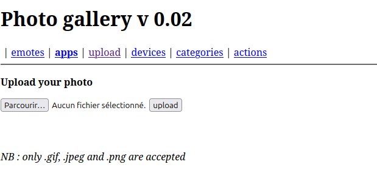

# File upload - Double extensions

## Infos

- Catégorie : Web - Serveur
- Difficulté / Points : 20
- Fichiers / URL fournis : galerie photo avec un formulaire d'upload

## Énoncé

Votre objectif est de compromettre cette galerie photo en y uploadant du code PHP.
Récupérez le mot de passe de validation dans le fichier .passwd à la racine de l’application.

## TL;DR

Le site n'accepte que les images, mais il vérifie mal l'extension. En nommant le fichier `file.php.png` (**double extension**), on passe le filtre et le serveur exécute quand même le code PHP. On peut alors exécuter des commandes avec un **webshell**.

## Reconnaissance

Le site propose d'uploader une photo. Il refuse toutes les extensions sauf `.png`, `.gif` et `.jpeg`.



Mon hypothèse : le filtre ne regarde que la fin du nom du fichier. Si je donne deux extensions au fichier, il peut passer le filtre tout en étant interprété comme du PHP par le serveur.

## Exploitation

1. Je crée un fichier `file.php.png` qui contient du code PHP.
2. Je l'uploade : le filtre l'accepte.
3. J'ouvre le fichier uploadé : le serveur exécute le code PHP.
4. Après plusieurs essais avec `ls` pour explorer les dossiers, je trouve le fichier `.passwd` trois dossiers plus haut et je l'affiche avec `cat` :
   ```php
   <?php
   // echo system("ls -a ../../../");
   echo system("cat ../../../.passwd");
   ?>
   ```
5. La page affiche le contenu du fichier, c'est-à-dire le flag.

   

## Flag

`masqué` *(règles Root-Me)*

## Ce que j'ai appris

- Un **webshell** est un script (souvent en PHP) déposé sur le serveur qui permet d'exécuter des commandes à distance.
- Vérifier seulement l'extension n'est pas suffisant : selon la configuration du serveur (Apache par exemple), `file.php.png` peut quand même être exécuté comme du PHP.
- Pour corriger : vérifier l'extension finale avec une liste blanche, vérifier le contenu réel du fichier, renommer les fichiers uploadés et les stocker dans un dossier où l'exécution de scripts est désactivée.
