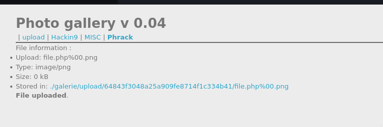

# File upload - Null byte

## Infos

- Catégorie : Web - Serveur
- Difficulté / Points : 25 points
- Fichiers / URL fournis : galerie photo avec un formulaire d'upload

## Énoncé

Your goal is to hack this photo galery by uploading PHP code.

## TL;DR

Le site n'accepte que les images PNG. Avec un **null byte** (`%00`) dans le nom du fichier, comme `file.php%00.png`, le filtre voit une image `.png`, mais le fichier est enregistré comme `file.php` et le code PHP est exécuté.

## Reconnaissance

Le challenge permet d'uploader des images PNG et refuse toutes les autres extensions.

Le **null byte** (`\0`, encodé `%00` dans une URL) marque la fin d'une chaîne de caractères en C. Certaines anciennes versions de PHP coupent le nom du fichier à cet endroit, ce qui permet de tromper l'application :
- le filtre lit tout le nom et voit `.png` à la fin ;
- le système enregistre seulement la partie avant le null byte, donc `file.php`.

## Exploitation

1. J'uploade un fichier avec du code PHP, que je nomme `file.php%00.png`.
2. Le serveur accepte le fichier et le considère comme une image (`Type: image/png`).

   
3. En ouvrant le fichier, le code PHP est exécuté et la page affiche :
   ```txt
   Well done ! You can validate this challenge with the password : [masqué]
   This file is already deleted.
   ```

## Flag

`masqué` *(règles Root-Me)*

## Ce que j'ai appris

- Le null byte permet de couper une chaîne de caractères trop tôt, et donc de bypass certains filtres sur les noms de fichiers.
- Cette faille ne marche que sur les vieilles versions de PHP (avant la 5.3.4) : il faut toujours garder ses versions à jour.
- Pour corriger : refuser tout nom de fichier contenant des caractères spéciaux, renommer les fichiers uploadés et les stocker dans un dossier non exécutable.

## Ressources

- [Secure file upload in PHP web applications (Root-Me)](https://repository.root-me.org/Exploitation%20-%20Web/EN%20-%20Secure%20file%20upload%20in%20PHP%20web%20applications.pdf)
- [HackTricks – File Upload](https://hacktricks.wiki/en/pentesting-web/file-upload/index.html)
