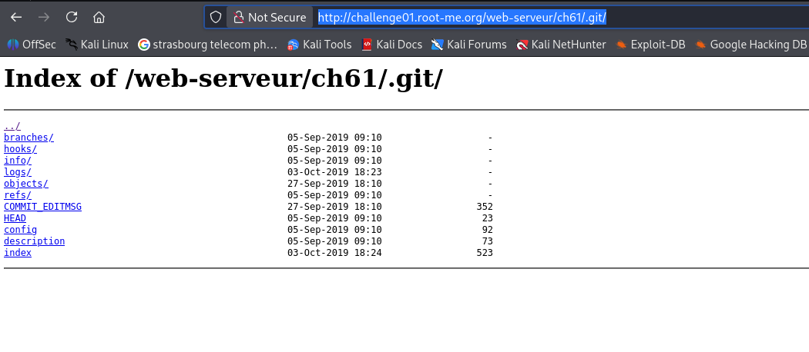
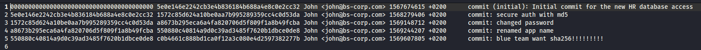
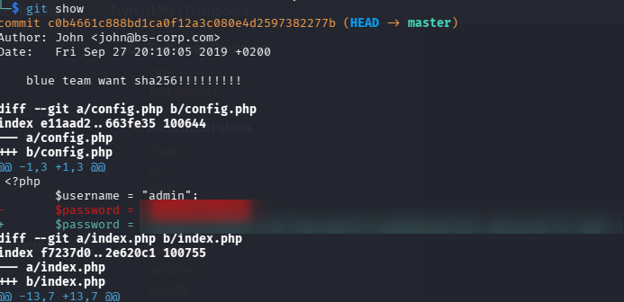

# Insecure Code Management

## Infos

- Catégorie : Web - Serveur
- Difficulté / Points : 20 points
- Fichiers / URL fournis : http://challenge01.root-me.org/web-serveur/ch61/

## Énoncé

Récupérez le mot de passe (en clair) du compte admin.

## TL;DR

Le dossier `.git` du site est accessible publiquement. On peut télécharger tout l'historique du projet avec **git-dumper** et retrouver, dans un ancien commit, le mot de passe admin en clair avant qu'il soit remplacé par un hash.

## Reconnaissance

La **gestion non sécurisée du code source** (*Insecure Source Code Management*) regroupe les mauvaises pratiques liées aux outils de versionnement comme Git ou SVN.

Premier réflexe : regarder directement dans l'URL si des répertoires connus sont accessibles, comme `.git`. Ici, on a bien accès au répertoire :

```txt
http://challenge01.root-me.org/web-serveur/ch61/.git/
```



On a déjà des informations utiles dans des fichiers comme `.git/logs/HEAD`, qui liste les commits et leurs messages (« changed password », « blue team want sha256 »…) :



## Exploitation

1. Pour vraiment naviguer dans les différents commits, il faut reconstruire le dépôt. J'utilise **git-dumper** pour récupérer le `.git` complet du site :
   ```bash
   git-dumper http://challenge01.root-me.org/web-serveur/ch61/.git .
   ```
2. Avec `git show`, on voit les modifications du dernier commit. Le mot de passe admin en clair a été remplacé par son hash SHA-256 : l'ancienne valeur apparaît donc dans le diff.

   

## Flag

`masqué` *(règles Root-Me)*

## Ce que j'ai appris

- Toujours tester les dossiers sensibles connus (`.git`, `.svn`, `.env`…) sur un site web.
- Supprimer un secret dans un nouveau commit ne suffit pas : il reste dans l'historique Git.
- Pour corriger : ne jamais déployer le dossier `.git` (ou bloquer son accès sur le serveur web), et changer tout secret qui a été commité.

## Ressources

- [PayloadsAllTheThings – Insecure Source Code Management](https://github.com/swisskyrepo/PayloadsAllTheThings/blob/master/Insecure%20Source%20Code%20Management/Git.md)
- [Documentation Git](https://git-scm.com/doc)
