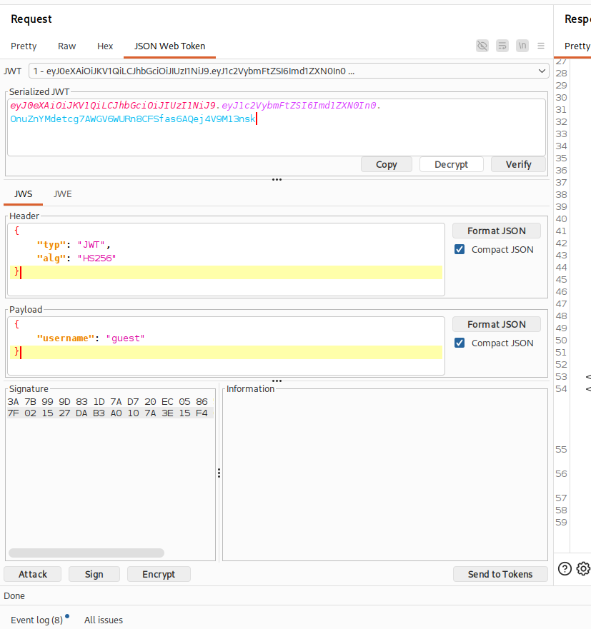
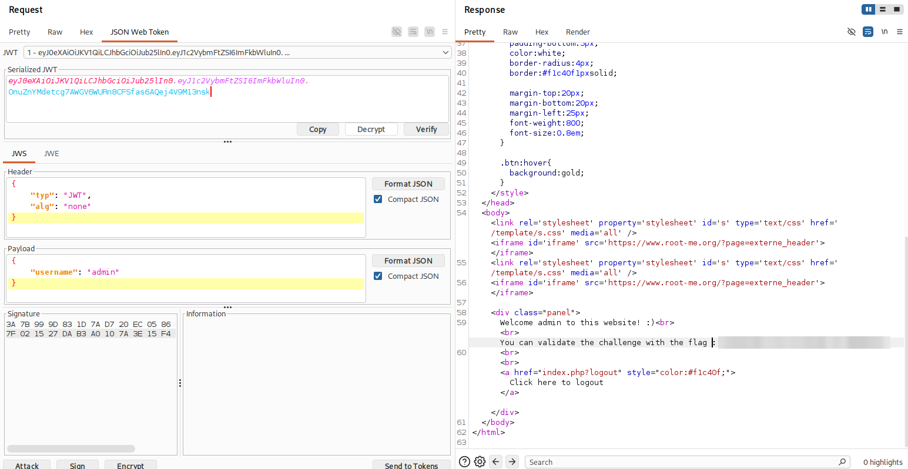

# JWT - Introduction

## Infos

- Catégorie : Web - Serveur
- Difficulté / Points : 20 points
- Fichiers / URL fournis : page de connexion

## Énoncé

Pour valider le challenge, connectez-vous en tant qu'admin.

## TL;DR

Le serveur accepte les **JWT** avec l'algorithme `none`, c'est-à-dire sans vérifier la signature. On peut donc modifier le token pour mettre `username` à `admin` et se connecter en tant qu'admin.

## Reconnaissance

Un **JWT** (*JSON Web Token*) est un token d'authentification en trois parties encodées en Base64 : `header.payload.signature`. Le header indique l'algorithme de signature (`alg`), le payload contient les infos de l'utilisateur, et la signature garantit que le token n'a pas été modifié.

Pour la série de challenges JWT, j'utilise l'extension Burp **JWT Editor**, qui décode et modifie les tokens directement dans Burp.

On a un formulaire : on peut soit se connecter avec des identifiants, soit se connecter en tant que guest. Je me connecte en guest pour avoir un token JWT que je peux intercepter avec Burp.



L'extension le décode pour moi : on voit `"alg": "HS256"` et `"username": "guest"`.

## Exploitation

1. Dans le payload, je change la valeur de `username` par `admin`.
2. Dans le header, je mets `alg` à `none` pour que le serveur ne vérifie pas la signature.
   ```json
   { "typ": "JWT", "alg": "none" }
   { "username": "admin" }
   ```
3. J'envoie la requête avec le token modifié : le serveur me souhaite la bienvenue en tant qu'admin et donne le flag.

   

## Flag

`masqué` *(règles Root-Me)*

## Ce que j'ai appris

- Le contenu d'un JWT est seulement encodé, pas chiffré : tout le monde peut le lire.
- Si le serveur accepte `alg: none`, la signature ne sert plus à rien et on peut modifier le token comme on veut.
- Pour corriger : refuser l'algorithme `none` et imposer côté serveur l'algorithme attendu.

## Ressources

- [JWT (JSON Web Token) – Orsys](https://www.orsys.fr/orsys-lemag/Glossaire/jwt-json-web-token-%F0%9F%9F%A2-protection/)
