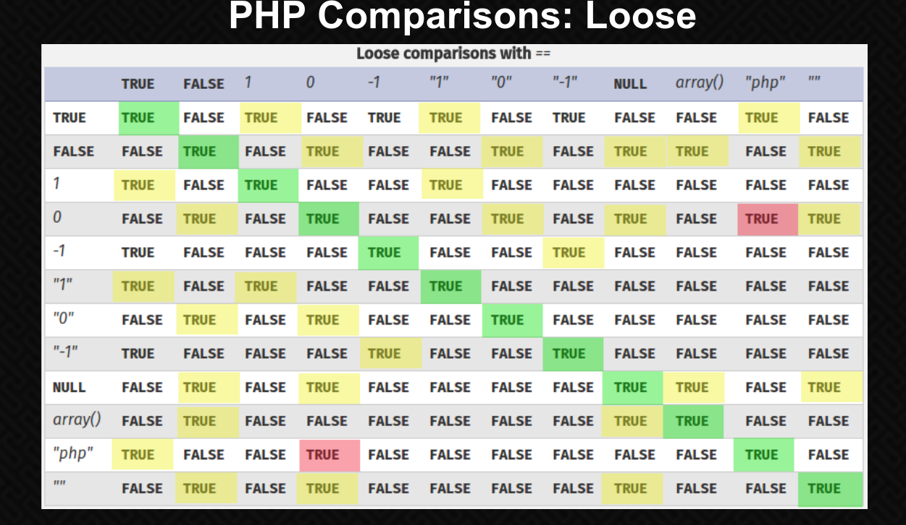
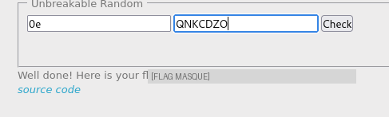

# PHP - Loose Comparison

## Infos

- Catégorie : Web - Serveur
- Difficulté / Points : 30 points
- Fichiers / URL fournis : le code source de la page (via `?source`)

## Énoncé

Trouvez un moyen d'obtenir le flag. Aucun bruteforce n'est nécessaire.

## TL;DR

Le code compare `$s.$r == $h` avec `==`, la comparaison **faible** de PHP. En envoyant un `h` dont le MD5 est un **magic hash** (de la forme `0e` suivie uniquement de chiffres, interprété comme `0`) et en mettant `s = "0e"`, les deux côtés valent `0` : la comparaison `0 == 0` est vraie et on obtient le flag.

## Reconnaissance

Le site propose deux champs : une valeur normale `s`, et une valeur `h` qui sera hachée en MD5. Le code source nous est fourni. Les parties qui comptent :

```php
function sanitize_user_input($input) {
    // ne garde que les caractères a-z, A-Z et 0-9
    return preg_replace('/[^a-zA-Z0-9]/', "", $input);
}

$s = sanitize_user_input($_POST['s']);   // notre entrée s, nettoyée
$h = secured_hash_function($_POST['h']); // md5 de notre entrée h, nettoyée
$r = gen_secured_random();               // un nombre aléatoire (que des chiffres)

if ($s != false && $h != false) {
    if ($s . $r == $h) {                 // <-- comparaison FAIBLE
        print "Well done! Here is your flag: " . $flag;
    }
}
```

La comparaison vulnérable est `$s.$r == $h`. Avec `==`, PHP fait du *type juggling* : il convertit les deux côtés avant de comparer. Je pense donc à jouer avec la table des comparaisons faibles de PHP.



## Exploitation

J'ai appris l'existence des **magic hash**. Ce sont des chaînes dont le MD5 a la forme `0e` suivie **uniquement de chiffres**, par exemple `0e830400...`. En comparaison faible, PHP lit `0e<chiffres>` comme une notation scientifique : `0 × 10^(chiffres) = 0`. La chaîne vaut donc `0`.

L'idée est de rendre les **deux côtés** égaux à `0` :

1. Pour `$h` : il faut une entrée dont le MD5 est un magic hash. J'utilise `QNKCDZO`, bien connu : `md5("QNKCDZO")` commence par `0e` et ne contient que des chiffres → vaut `0`. Il passe le filtre `sanitize` (que des lettres).
2. Pour `$s.$r` : je mets `s = "0e"`. Comme `$r` n'est que des chiffres, la concaténation donne `"0e" + <chiffres>` = `0e<chiffres>` → vaut aussi `0`.

Résultat : `$s.$r == $h` devient `0 == 0`, c'est vrai.

```
s = 0e
h = QNKCDZO
```



> Le test `$s != false && $h != false` juste avant ne gêne pas : `"0e"` est une chaîne non vide (donc différente de `false`) et le hash de `h` est une chaîne de 32 caractères.

## Flag

`masqué` *(règles Root-Me)* — le flag est un clin d'œil : « crains les comparaisons faibles ».

## Ce que j'ai appris

1. Le fonctionnement des **comparaisons faibles** (`==`) en PHP et du *type juggling*.
2. Les **magic hash** : des chaînes dont le MD5 a la forme `0e<chiffres>`, interprété comme `0` en comparaison numérique (ce n'est pas du Python : `0e123` est une notation scientifique = `0 × 10^123 = 0`).
3. **Précision importante** : PHP 8 a corrigé le cas `0 == "abc"` (qui donnait `true` avant), mais le magic hash marche toujours, car ici **les deux côtés** sont des chaînes numériques `0e<chiffres>` comparées comme des nombres.
4. **Remédiation** : utiliser la comparaison stricte `===` (ou `!==`), qui compare aussi le type et n'est pas trompée par `0e...`. Et ne pas utiliser MD5 pour quoi que ce soit de sensible.
