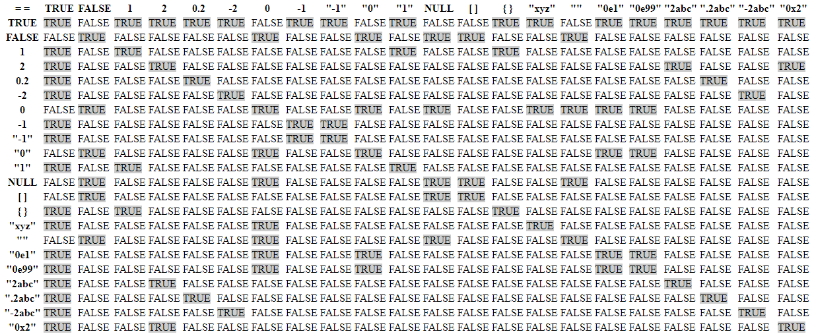
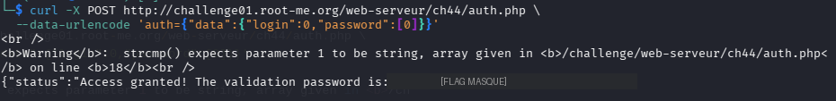

# PHP - type juggling

## Infos

- Catégorie : Web - Serveur
- Difficulté / Points : 30 points
- Fichiers / URL fournis : un formulaire login / password, code source via `?source`

## Énoncé

Obtenir un accès.

## TL;DR

Le code vérifie l'authentification avec deux comparaisons faibles : un `==` sur le login, et un `strcmp()` sur le mot de passe. On exploite les deux : `login = 0` passe la première (type juggling), et envoyer `password` sous forme de **tableau** fait renvoyer `NULL` à `strcmp()` dans les vieilles versions de PHP, ce qui valide la seconde.

## Reconnaissance

Je commence par lire le code source. La ligne importante :

```php
$auth = @json_decode($_POST['auth'], true);

if ($auth['data']['login'] == $USER
    && !strcmp($auth['data']['password'], $PASSWORD_SHA256)) {
    $return['status'] = "Access granted! The validation password is: $FLAG";
}
```

Deux conditions à valider en même temps :
1. `$auth['data']['login'] == $USER` : notre login doit être « égal » à une valeur `$USER` qu'on ne voit pas, avec le `==` **faible**.
2. `!strcmp($auth['data']['password'], $PASSWORD_SHA256)` : `strcmp` renvoie `0` quand les deux chaînes sont identiques, donc `!strcmp(...)` est vrai quand les mots de passe sont égaux.

On entre les données en **JSON**, via un champ `auth`.



## Exploitation

**Première condition (`login == $USER`).** Je m'aide de la table des comparaisons faibles. `$USER` est une chaîne qu'on ne connaît pas (un mot, type `"xyz"` dans la table). Or dans la colonne `"xyz"`, la valeur `0` (entier) vaut `TRUE` : en PHP, `0 == "une chaîne de texte"` était vrai (la chaîne est convertie en `0`). Donc **`login = 0`** (en entier, pas en texte) passe la première condition.

**Seconde condition (`!strcmp(...)`).** Là c'est plus dur, car `strcmp` compare les chaînes correctement. Mais dans les anciennes versions de PHP, `strcmp` ne gère pas le cas où on lui passe un **tableau** au lieu d'une chaîne : il émet un warning et renvoie **`NULL`**. Et `!NULL` vaut `TRUE`. Donc en envoyant `password` comme un tableau, la condition passe.

Je construis donc ce JSON :

```json
{"data":{"login":0,"password":[0]}}
```

Je l'envoie avec **curl**, car depuis le formulaire (et même via Burp) le mot de passe était directement transformé en hash SHA-256, ce qui m'empêchait d'envoyer un tableau :

```bash
curl -X POST http://challenge01.root-me.org/web-serveur/ch44/auth.php \
  --data-urlencode 'auth={"data":{"login":0,"password":[0]}}'
```

Le serveur renvoie le warning `strcmp() expects parameter 1 to be string, array given`, puis **Access granted** :



## Flag

`masqué` *(règles Root-Me)* — le flag est un clin d'œil : « n'oublie pas la comparaison faible de PHP ».

## Ce que j'ai appris

1. Chercher des faiblesses dans des fonctions PHP, ici `strcmp`.
2. Enchaîner **deux** conditions faibles dans une même requête.
3. Le passage d'un **tableau** à une fonction qui attend une chaîne (`strcmp`) renvoie `NULL` dans les vieux PHP, et `!NULL == true`.
4. Quand le JavaScript du formulaire modifie l'entrée (ici, hachage côté client), passer par **curl** pour envoyer exactement ce qu'on veut au serveur.
5. **Remédiation** : utiliser la comparaison stricte `===`, vérifier le **type** des entrées (`is_string()`) avant de les passer à `strcmp`, et comparer les hashs avec `hash_equals()`.
